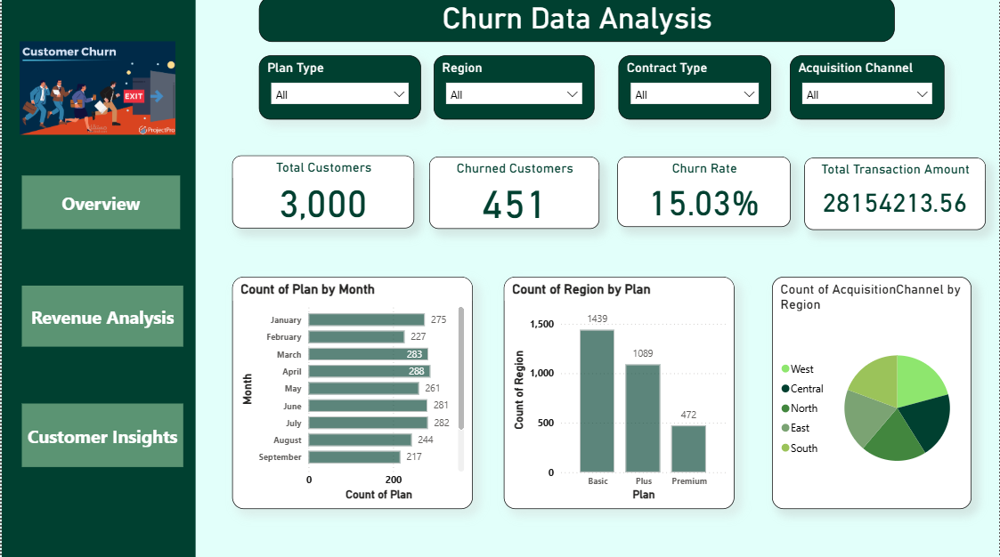
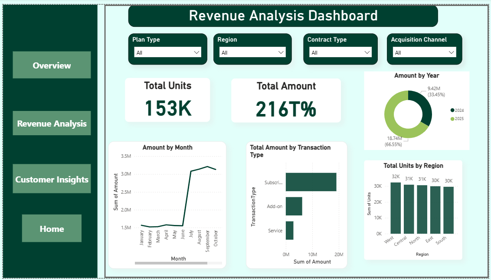
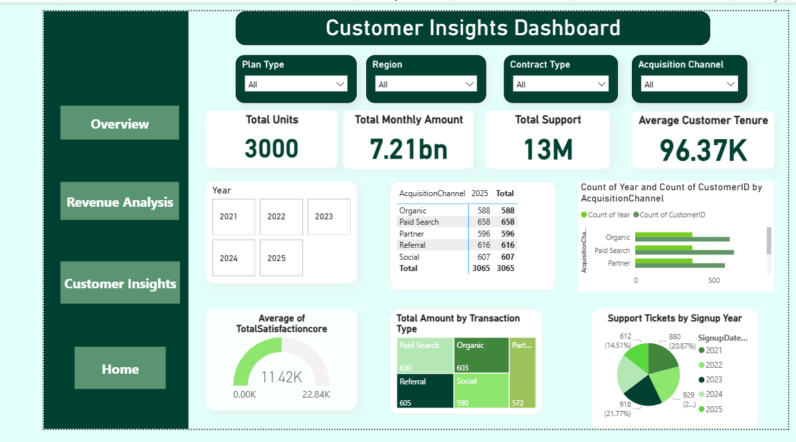

# Customer Churn Analysis Dashboard | Power BI

## Project Overview
This project presents an interactive, three-page Power BI dashboard designed to explore customer churn, transaction amounts, and customer insights using a Kaggle dataset.

## Tools & Technologies
- Power BI Desktop
- Power Query
- DAX
- Kaggle Dataset

## Dashboard Pages

### 1. Overview
Provides an overview of customer metrics, churn rate, and customer distribution.

### 2. Revenue Analysis
Visualizes transaction amounts, revenue-related metrics, and transaction trends.

### 3. Customer Insights
Explores customer characteristics, tenure, satisfaction, and other available customer metrics.

## Key Features
- Interactive dashboard visualizations
- KPI cards and charts
- Data cleaning and transformation using Power Query
- DAX measures for data analysis
- Filters and slicers for exploring customer segments

## Project File
`Customer_Churn_Analysis.pbix` – Power BI report containing all three dashboard pages.

## Dataset
Source: Kaggle

## Author
Harshavardhini M

[GitHub Profile](https://github.com/HARSHAVARDHINIMADESH)
